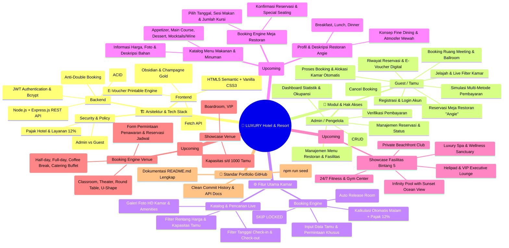
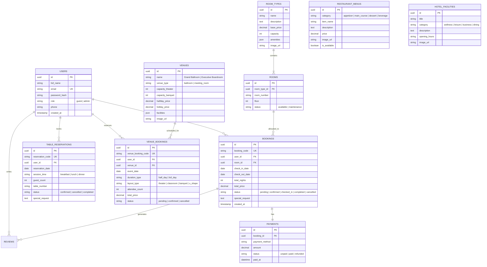

# 🏨 Hotel Booking Web Service - Project Mindmap & Architecture
### LUXURY Hotel & Resort - Master System Roadmap

Dokumen ini berisi peta konsep (*mindmap*), arsitektur sistem, skema database, dan rencana roadmap fitur untuk pengembangan aplikasi **LUXURY Hotel & Resort Web Service**.

---

## 📌 1. Mermaid Visual Mindmap



---

## 🌳 2. Plain Text Hierarchy Mindmap

```text
LUXURY HOTEL & RESORT WEB SERVICE
├── 1. ARSITEKTUR & TECH STACK
│   ├── Backend: Node.js (Express.js) - REST API
│   ├── Frontend: HTML5, CSS3 Modern (Obsidian & Champagne Gold), Vanilla JS
│   ├── Database: PostgreSQL (Relational Integrity, ACID, Row-Level Locking)
│   ├── Security: JWT Authentication & Bcrypt Password Hashing
│   └── Kebijakan Keuangan: Tarif Pajak & Layanan Flat 12%
│
├── 2. MODUL USER & FITUR
│   ├── Guest (Pengunjung / Tamu)
│   │   ├── Register & Login Akun Tamu
│   │   ├── Pencarian & Live Filter Kamar (Tanggal, Tamu, Harga)
│   │   ├── Booking Kamar Otomatis (Anti-Double Booking)
│   │   ├── Simulasi Pembayaran (VA BCA/Mandiri, QRIS, Kartu Kredit)
│   │   ├── Pembatalan Reservasi (Cancel Booking)
│   │   ├── Riwayat Reservasi Saya & Cetak E-Voucher PDF
│   │   ├── [NEW] Jelajah Restoran "Angie", Menu & Reservasi Meja
│   │   ├── [NEW] Jelajah Fasilitas Hotel & Leisure
│   │   └── [NEW] Reservasi Grand Ballroom & Ruang Meeting (MICE)
│   │
│   └── Admin (Staff / Pengelola Hotel)
│       ├── Dashboard Analytics (Revenue, Okupansi Kamar, Statistik Booking)
│       ├── Manajemen Kamar & Tipe Kamar (CRUD)
│       ├── Manajemen Status Reservasi (Confirm, Check-in, Check-out, Cancel)
│       ├── [NEW] Manajemen Menu Restoran "Angie" & Reservasi Meja
│       └── [NEW] Manajemen Jadwal & Booking Ballroom / Meeting Room
│
├── 3. CORE BUSINESS LOGIC
│   ├── Algoritma Anti-Double Booking (SELECT ... FOR UPDATE SKIP LOCKED)
│   ├── Pricing Engine (Nights × Base Price + Tax 12%)
│   ├── Cancellation Engine (Pelepasan Alokasi Kamar Otomatis)
│   └── Unique Code Generators:
│       ├── Kamar: HTL-YYYYMMDD-XXX
│       ├── Restoran: RST-YYYYMMDD-XXX
│       └── MICE / Venue: VEN-YYYYMMDD-XXX
│
├── 4. SKEMA DATABASE UTAMA
│   ├── users (Akun Tamu & Admin)
│   ├── room_types (Standard, Deluxe, Suite, Executive Family)
│   ├── rooms (Unit Fisik Kamar, Lantai, Status)
│   ├── bookings (Data Reservasi Kamar, Durasi, Total Harga)
│   ├── payments (Status Bayar, Metode, Waktu Transaksi)
│   ├── [NEW] restaurant_menus (Daftar Menu Restoran Angie)
│   ├── [NEW] table_reservations (Reservasi Meja Restoran Angie)
│   ├── [NEW] hotel_facilities (Daftar Fasilitas & Fasilitas Kamar)
│   ├── [NEW] venues (Grand Ballroom & Meeting Rooms)
│   └── [NEW] venue_bookings (Reservasi Event & Ruang Meeting)
│
└── 5. STANDAR KESIAPAN GITHUB (PORTFOLIO)
    ├── README.md Interaktif (Screenshot, GIF, Arsitektur, ERD, Step-by-Step Run)
    ├── Data Seeder Otomatis (npm run seed)
    ├── Dokumentasi REST API Lengkap
    └── Clean Git History
```

---

## 📊 3. Entity Relationship Diagram (Database Schema Lengkap)



---

## 🎯 4. Roadmap Tahapan Pengembangan

- [x] **Fase 1: Setup & Database Initialization**
  - Setup Node.js Express & PostgreSQL.
  - Skema database relasional (`schema.sql`) & seeder data otomatis (`seed.js`).
- [x] **Fase 2: Autentikasi & Authorization**
  - Register & Login dengan Bcrypt Password Hashing.
  - JWT Authentication Middleware & Role-Based Access Control (Admin vs Guest).
- [x] **Fase 3: REST API Kamar & Booking Engine**
  - Endpoint CRUD Kamar & Room Types.
  - Endpoint cek ketersediaan kamar dengan filter tanggal & kapasitas.
  - Endpoint pembuatan reservasi dengan alokasi otomatis (ACID Transaction & Lock).
  - Integrasi perhitungan Pajak Hotel & Layanan 12%.
  - Endpoint pembatalan reservasi (*Cancel Booking* & pelepasan kamar).
- [x] **Fase 4: Antarmuka Web (Frontend) - "LUXURY Hotel & Resort"**
  - Desain mewah (*Deep Obsidian & Champagne Gold*).
  - Floating Live Search Bar, Dynamic API Auto-Detection.
  - Suite Modal Interaktif (Login/Register, Booking Form, Simulasi Pembayaran, Riwayat Pemesanan, E-Voucher Cetak PDF).
  - Fitur Cancel Booking langsung dari UI tamu.
- [x] **Fase 5: Dashboard Admin & Dokumentasi Portfolio GitHub**
  - Dashboard statistik analitik (Total Pendapatan, Okupansi Kamar, Status Reservasi).
  - Panel kontrol manajemen reservasi & kamar bagi Admin.
  - Pembuatan dokumentasi `README.md` komprehensif (Screenshot, API Docs, Panduan Setup).
- [x] **Fase 6: Ekosistem Layanan Hotel Lengkap (Restoran "Angie", Fasilitas & MICE/Ballroom)**
  - **Task 6.1: Modul Restoran "Angie"**
    * Profil & deskripsi atmosfer fine dining Restoran Angie.
    * Katalog menu makanan & minuman (Appetizer, Main Course, Dessert, Drinks) dengan foto HD & harga.
    * Form & Engine Reservasi Meja Restoran (pilih tanggal, sesi makan, jumlah tamu, catatan alergi/preferensi).
  - **Task 6.2: Showcase Fasilitas Hotel Bintang 5**
    * Halaman/Section interaktif fasilitas hotel (Infinity Pool, Luxury Spa & Wellness, 24/7 Gym, Helipad, Beach Lounge).
    * Informasi jam buka, lokasi lantai, dan detail layanan fasilitas.
  - **Task 6.3: Booking Engine Grand Ballroom & Ruang Meeting (MICE)**
    * Katalog venue (Grand Ballroom, Executive Boardroom, Meeting Suites).
    * Konfigurasi layout (Theater, Classroom, Banquet, U-Shape) & kapasitas peserta.
    * Pemilihan paket durasi (Half-day / Full-day) & layanan catering/coffee break.
    * Form pengajuan reservasi venue & kalkulasi estimasi biaya event.
  - **Task 6.4: Backend REST API & Skema Database Fasilitas, Restoran & Venue**
    * Endpoint CRUD Menu & Reservasi Meja Restoran Angie (`/api/v1/restaurant/...`).
    * Endpoint Fasilitas Hotel (`/api/v1/facilities/...`).
    * Endpoint Katalog & Booking Venue/Ballroom (`/api/v1/venues/...`).
