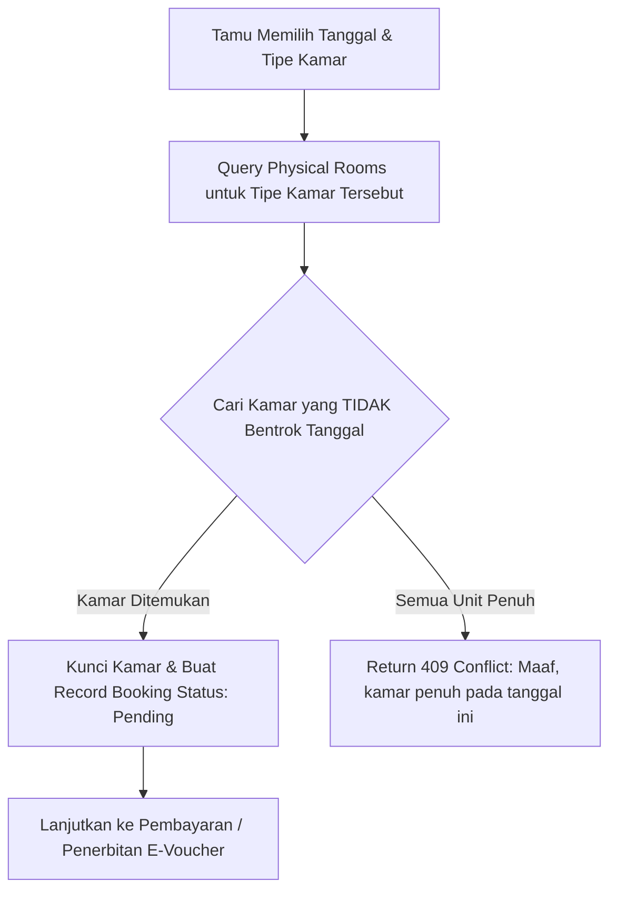
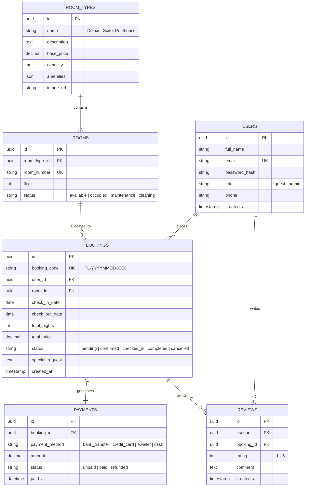

# 🏨 LUXURY Hotel & Resort — Web Service & Enterprise Management Platform

[](https://nodejs.org/)
[](https://expressjs.com/)
[](https://www.postgresql.org/)
[](https://jwt.io/)
[](https://developer.mozilla.org/)
[](LICENSE)

Platform web service dan sistem manajemen reservasi perhotelan bintang 5 bertaraf industri (**LUXURY Hotel & Resort**). Dibangun dengan arsitektur **RESTful API** berbasis Node.js & Express.js, database relasional **PostgreSQL**, sistem keamanan berlapis (*Role-Based Access Control* dengan JWT & Bcrypt), algoritma alokasi kamar dinamis (*Anti-Double Booking*), kalkulasi pajak regulasi perhotelan 12%, serta antarmuka web ultra-premium (*Deep Obsidian & Champagne Gold Glassmorphism*).

---

## 📑 Daftar Isi
- [✨ Fitur Utama](#-fitur-utama)
- [🏛️ Arsitektur & Logika Bisnis](#️-arsitektur--logika-bisnis)
- [🗄️ Skema Database Relasional (ERD)](#️-skema-database-relasional-erd)
- [🛠️ Tech Stack](#️-tech-stack)
- [📂 Struktur Direktori Proyek](#-struktur-direktori-proyek)
- [🔌 Dokumentasi API Endpoints](#-dokumentasi-api-endpoints)
- [🚀 Panduan Instalasi & Menjalankan](#-panduan-instalasi--menjalankan)
- [🔑 Akun Demo (Seeder)](#-akun-demo-seeder)
- [🗺️ Roadmap Pengembangan](#️-roadmap-pengembangan)
- [📄 Lisensi](#-lisensi)

---

## ✨ Fitur Utama

### 👤 1. Portal Tamu (Guest Experience)
* **Real-time Live Availability Search:** Mesin pencari ketersediaan kamar dinamis dengan filter tanggal Check-in/Check-out, jumlah tamu, dan rentang tarif.
* **Katalog Kamar Interaktif:** Showcase tipe kamar (Deluxe, Executive Suite, Ocean Presidential, Penthouse) lengkap dengan galeri foto beresolusi tinggi, daftar amenities, rating bintang, dan status unit kosong.
* **Booking Engine & Tax Breakdown:**
  * Kalkulasi otomatis durasi malam dan rincian harga transparan.
  * Perhitungan Pajak Hotel & Layanan 12% secara *real-time*.
  * Form data reservasi dengan catatan permintaan khusus (*Special Requests*).
* **Simulasi Pembayaran Interaktif (Payment Simulator):**
  * Dukungan Virtual Account (BCA/Mandiri), QRIS (GoPay/OVO/ShopeePay), Kartu Kredit, dan Tunai di Resepsionis.
* **E-Voucher Digital & Printable:** E-Voucher resmi dengan kode booking unik (`HTL-YYYYMMDD-XXX`), rincian kamar, lantai, dan rincian finansial.
* **Manajemen & Pembatalan Reservasi (Cancel Booking):** Tamu dapat membatalkan pesanan status *pending* / *confirmed*, yang secara otomatis mengembalikan unit kamar ke status `available`.

### 🛡️ 2. Portal Manajemen & Dashboard Admin
* **Analitik & KPI Real-Time:** Monitoring total pendapatan (*total revenue*), persentase tingkat okupansi (*occupancy rate*), perbandingan kamar terisi vs kosong, dan jumlah booking hari ini.
* **Manajemen Reservasi Tamu:**
  * Filter booking berdasarkan status (*All, Pending, Confirmed, Checked-in, Completed, Cancelled*) & pencarian nama/kode.
  * Aksi cepat *One-Click*: **Konfirmasi Booking**, **Proses Check-In** (otomatis mengubah status kamar menjadi *Occupied*), **Proses Check-Out** (mengembalikan kamar ke *Available*), dan **Batalkan Reservasi**.
* **Inventori Kamar Fisik (Per Lantai):**
  * Grid visual status seluruh unit kamar fisik yang dikelompokkan per lantai.
  * Indikator nama tamu aktif dan kode booking yang sedang menempati kamar.
  * Quick status toggle: `Available`, `Occupied`, `Maintenance`, `Cleaning`.
  * Modal input penambahan unit kamar fisik baru.
* **Direktori Tamu (Guest CRM):** Rekapitulasi profil tamu, total riwayat booking, dan akumulasi nilai transaksi (*Total Spent*).

---

## 🏛️ Arsitektur & Logika Bisnis

### ⚙️ 1. Algoritma Anti-Double Booking
Sistem mencegah pemesanan ganda pada kamar dan tanggal yang sama dengan memverifikasi kondisi bentrok rentang tanggal (*overlapping date range*):

$$\text{Existing Check-In} < \text{Requested Check-Out} \quad \text{DAN} \quad \text{Existing Check-Out} > \text{Requested Check-In}$$

Jika terdapat reservasi aktif (`pending`, `confirmed`, `checked_in`) yang memenuhi irisan tanggal di atas untuk suatu kamar, maka unit tersebut **dikeluarkan dari daftar kamar tersedia** dan tidak dapat dipilih oleh tamu lain.



### 💰 2. Kalkulasi Finansial & Pajak 12%
* $\text{Subtotal} = \text{Base Price} \times \text{Durasi Malam}$
* $\text{Tax Amount} = \text{Subtotal} \times 0.12$ (12% Pajak Hotel & Layanan)
* $\text{Total Price} = \text{Subtotal} + \text{Tax Amount}$

---

## 🗄️ Skema Database Relasional (ERD)



---

## 🛠️ Tech Stack

| Layer | Komponen & Library |
| :--- | :--- |
| **Backend Runtime** | [Node.js](https://nodejs.org/) (v18+) & [Express.js](https://expressjs.com/) RESTful Engine |
| **Database Engine** | [PostgreSQL](https://www.postgresql.org/) dengan koneksi pooling via `pg` |
| **Security & Headers**| `jsonwebtoken` (JWT), `bcryptjs`, `helmet`, `cors`, SQL Parameterized Queries (Anti SQL-Injection) |
| **Frontend Architecture**| Semantic HTML5, Vanilla JavaScript (ES6+ SPA Logic & Fetch API), Vanilla CSS3 (*Theme: Obsidian & Champagne Gold*) |
| **Icons & Typography** | FontAwesome 6 Pro, Google Fonts (*Playfair Display* & *Plus Jakarta Sans*) |

---

## 📂 Struktur Direktori Proyek

```text
web-booking-hotel/
├── backend/
│   ├── config/              # Inisialisasi Database Pool & Schema DDL
│   │   ├── db.js
│   │   ├── schema.sql       # Skema Relasional DDL
│   │   └── seeder.sql       # Data Awal Kamar & User Admin
│   ├── controllers/         # Handler Logika Bisnis
│   │   ├── authController.js
│   │   ├── roomController.js
│   │   ├── bookingController.js
│   │   └── adminController.js
│   ├── middleware/          # JWT Verification & Role Guard
│   │   └── authMiddleware.js
│   ├── routes/              # Routing Modul REST API
│   │   ├── authRoutes.js
│   │   ├── roomRoutes.js
│   │   ├── bookingRoutes.js
│   │   └── adminRoutes.js
│   ├── utils/               # Helper Kode Booking & Kalkulator
│   │   └── helpers.js
│   ├── .env.example
│   ├── package.json
│   └── server.js            # Entry Point Backend Server
├── frontend/
│   ├── assets/              # Static Resources
│   │   ├── css/
│   │   │   ├── style.css    # Guest UI Stylesheet
│   │   │   └── admin.css    # Admin Dashboard Stylesheet
│   │   └── js/
│   │       ├── app.js       # Guest Controller & Booking Engine
│   │       └── admin.js     # Admin Dashboard Controller
│   ├── index.html           # Guest Portal Landing & Booking Page
│   └── admin.html           # Admin Dashboard Portal
├── MINDMAP.md               # Visual Mindmap Pengembangan
├── PLAINTEXT.md             # Plaintext Checklist Roadmap
└── README.md                # Dokumentasi Portofolio Resmi
```

---

## 🔌 Dokumentasi API Endpoints

### 🔐 1. Modul Autentikasi (`/api/v1/auth`)
| Method | Endpoint | Hak Akses | Deskripsi |
| :--- | :--- | :--- | :--- |
| `POST` | `/register` | Public | Mendaftarkan akun tamu baru |
| `POST` | `/login` | Public | Login akun tamu/admin & mendapatkan JWT Token |
| `GET` | `/me` | Authenticated | Mendapatkan profil akun user yang aktif |

### 🛏️ 2. Modul Kamar & Ketersediaan (`/api/v1/rooms`)
| Method | Endpoint | Hak Akses | Deskripsi |
| :--- | :--- | :--- | :--- |
| `GET` | `/` | Public | Mengambil katalog seluruh tipe kamar & rating |
| `GET` | `/search/availability` | Public | Pencarian ketersediaan kamar kosong berdasarkan tanggal & kapasitas |
| `GET` | `/:id` | Public | Mengambil detail spesifikasi tipe kamar tertentu |

### 📅 3. Modul Reservasi & Transaksi (`/api/v1/bookings`)
| Method | Endpoint | Hak Akses | Deskripsi |
| :--- | :--- | :--- | :--- |
| `POST` | `/` | Guest | Membuat reservasi kamar (alokasi unit otomatis & hitung pajak 12%) |
| `GET` | `/my-bookings` | Guest | Melihat daftar riwayat seluruh reservasi milik tamu |
| `GET` | `/:id` | Guest/Admin | Mengambil data lengkap e-voucher & invoice reservasi |
| `POST` | `/:id/pay` | Guest | Memproses simulasi pembayaran (*Virtual Account, QRIS, Kartu*) |
| `POST` | `/:id/cancel` | Guest/Admin | Membatalkan reservasi & melepaskan alokasi kamar |

### 🛡️ 4. Modul Admin & Pengelola Hotel (`/api/v1/admin`)
*(Wajib Header: `Authorization: Bearer <ADMIN_JWT_TOKEN>`)*

| Method | Endpoint | Hak Akses | Deskripsi |
| :--- | :--- | :--- | :--- |
| `GET` | `/stats` | Admin | Statistik KPI (Total Revenue, Okupansi %, Booking hari ini, Recent activity) |
| `GET` | `/bookings` | Admin | Seluruh riwayat reservasi dengan filter status & keyword pencarian |
| `PUT` | `/bookings/:id/status` | Admin | Mengubah status booking (*confirmed, checked_in, completed, cancelled*) |
| `GET` | `/rooms` | Admin | Data seluruh kamar fisik, tipe kamar, dan status tamu aktif |
| `POST` | `/rooms` | Admin | Menambahkan unit kamar fisik baru (nomor kamar, lantai, tipe) |
| `PUT` | `/rooms/:id/status` | Admin | Mengubah status fisik kamar (*available, occupied, maintenance, cleaning*) |
| `GET` | `/guests` | Admin | Direktori data tamu terdaftar dan akumulasi total transaksi |

---

## 🚀 Panduan Instalasi & Menjalankan

### 1. Prasyarat Sistem
* [Node.js](https://nodejs.org/) (Versi 18 atau lebih baru)
* [PostgreSQL](https://www.postgresql.org/) (Versi 14+)

### 2. Kloning Repositori
```bash
git clone https://github.com/username/web-booking-hotel.git
cd web-booking-hotel
```

### 3. Konfigurasi Backend
```bash
cd backend
npm install
```

Buat file `.env` di dalam folder `backend/`:
```env
PORT=5000
DB_HOST=localhost
DB_PORT=5432
DB_NAME=hotel_booking_db
DB_USER=postgres
DB_PASSWORD=yourpassword
JWT_SECRET=supersecret_luxury_jwt_2026
```

### 4. Menjalankan Server
```bash
npm start
```
* Backend API: `http://localhost:5000/api/v1`
* Web Frontend Tamu: `http://localhost:5000/index.html`
* Web Dashboard Admin: `http://localhost:5000/admin.html`

---

## 🔑 Akun Demo (Seeder)

| Role | Email | Password | Kegunaan |
| :--- | :--- | :--- | :--- |
| **Administrator** | `admin@luminaresort.com` | `admin123` | Login ke Dashboard Admin & Mengelola Operasional |
| **Guest (Tamu)** | `budi@gmail.com` | `tamu123` | Uji coba reservasi kamar & e-voucher |

---

## 🗺️ Roadmap Pengembangan

- [x] **Fase 1: Fondasi & Perancangan Arsitektur** (Mindmap, ERD, DDL PostgreSQL)
- [x] **Fase 2: Backend Autentikasi & Keamanan** (JWT, Bcrypt, Middleware RBAC)
- [x] **Fase 3: Core Booking Engine** (Anti-Double Booking, Pajak 12%, Cancel Flow)
- [x] **Fase 4: Antarmuka Web Frontend Tamu** (LUXURY Hotel Landing, Live Search, E-Voucher)
- [x] **Fase 5: Dashboard Admin & Dokumentasi Portofolio** (KPI Stats, Room Inventory, Booking Management, Guest CRM)
- [ ] **Fase 6: Ekosistem Layanan Hotel Lengkap** *(Berikutnya)*:
  - 🍽️ **Restoran "Angie":** Profil fine dining, katalog menu culinary, dan reservasi meja makan.
  - 🏊 **Fasilitas Hotel Bintang 5:** Showcase Infinity Pool, Royal Spa & Wellness, Fitness Center.
  - 🏛️ **MICE & Ballroom Booking:** Ruang meeting, grand ballroom, konfigurasi layout (Classroom/Theatre/U-Shape), dan paket durasi.

---

## 📄 Lisensi
Didistribusikan di bawah lisensi **MIT License**.
Dibuat dengan dedikasi untuk portofolio standar industri rekayasa perangkat lunak full-stack.
